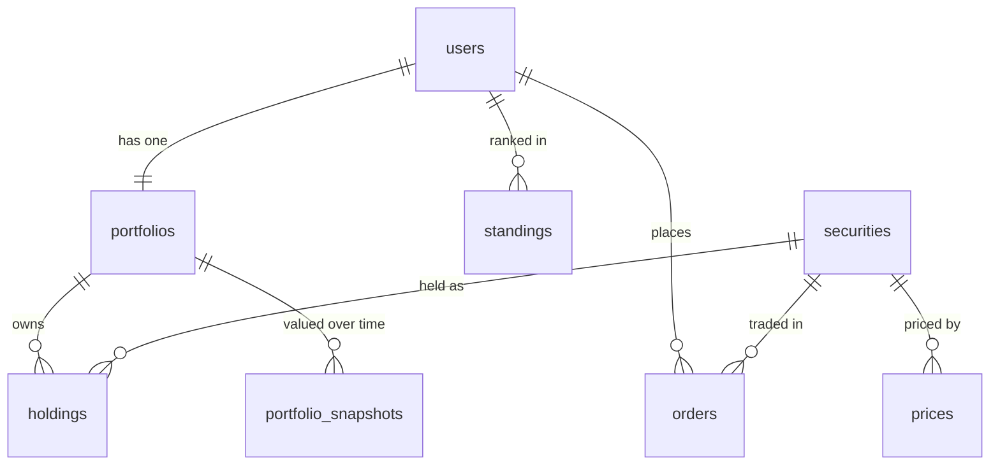

# Database schema

The current Postgres schema of the app's database: every table, its fields, its indexes, and how the tables connect.

- **Source of truth:** the migrations in [api/migrations/](../api/migrations/). This file describes the schema after all of them have run.
- **Keep it in sync:** every new migration updates this file in the same commit.
- **Last migration covered:** `20261108120000000_trade.sql`

## Relationships

`usd_ils` and `world_clock` stand alone and have no foreign keys.

| From | To | Type | On delete |
|------|----|------|-----------|
| `portfolios.uid` | `users.uid` | 1 to 1 | CASCADE |
| `holdings.uid` | `portfolios.uid` | many to 1 | CASCADE |
| `holdings.symbol` | `securities.symbol` | many to 1 | blocked |
| `orders.uid` | `users.uid` | many to 1 | CASCADE |
| `orders.symbol` | `securities.symbol` | many to 1 | blocked |
| `portfolio_snapshots.uid` | `portfolios.uid` | many to 1 | CASCADE |
| `standings.uid` | `users.uid` | many to 1 | CASCADE |
| `prices.symbol` | `securities.symbol` | many to 1 | blocked |

Deleting a user removes their portfolio, holdings, orders, snapshots and standings. A security can't be deleted while anything still refers to it.

## Tables

### `users`
One row per player. Firebase Auth owns the login; this row owns the app data.

| Field | Type | Null | Default | Notes |
|-------|------|------|---------|-------|
| `uid` | TEXT | no | | **PK.** The Firebase Auth uid (the JWT's `sub`) |
| `email` | TEXT | no | | Copied from the verified token on every login |
| `roles` | TEXT[] | no | `'{user}'` | Non-empty, only `admin` / `user`. Changed only with SQL |
| `theme` | TEXT | no | `'dark'` | `dark` or `light` (D-007) |
| `created_at` | TIMESTAMPTZ | no | `now()` | |
| `display_name` | TEXT | yes | | Shown on the leaderboard. Never the email |
| `chart_settings` | JSONB | no | `'{}'` | Chart type, colors, indicators. Written only by `PATCH /me/chart-settings` |

### `securities`
The securities in the game.

| Field | Type | Null | Default | Notes |
|-------|------|------|---------|-------|
| `symbol` | TEXT | no | | **PK.** Game ticker: `TEVA`, `NVDA` |
| `name_he` | TEXT | no | | Hebrew name shown in the app |
| `name_en` | TEXT | yes | | English name |
| `market` | TEXT | no | | `TASE` or `US`. Decides the trading hours |
| `exchange` | TEXT | no | | `TASE`, `NASDAQ` or `NYSE` |
| `currency` | TEXT | no | | `ILS` or `USD`. TASE prices are stored in ₪, not agorot |
| `yahoo_symbol` | TEXT | yes | | **Unique.** `TEVA.TA`, `BRK-B`. Used by the chart (D-012). NULL = no chart |

### `prices`
One row per security per trading day, in the security's currency.

| Field | Type | Null | Default | Notes |
|-------|------|------|---------|-------|
| `symbol` | TEXT | no | | **PK part.** FK → `securities.symbol` |
| `day` | DATE | no | | **PK part.** Trading day, in the exchange's time zone |
| `open` | NUMERIC(14,4) | no | | > 0 |
| `close` | NUMERIC(14,4) | no | | > 0 |

### `usd_ils`
The USD/ILS rate per day (₪ per $1).

| Field | Type | Null | Default | Notes |
|-------|------|------|---------|-------|
| `day` | DATE | no | | **PK** |
| `open` | NUMERIC(10,4) | no | | > 0 |
| `close` | NUMERIC(10,4) | no | | > 0 |

### `world_clock`
The one shared game clock. At most one row; no row means the world hasn't started.

| Field | Type | Null | Default | Notes |
|-------|------|------|---------|-------|
| `id` | BOOLEAN | no | `TRUE` | **PK.** Must be TRUE, which allows only one row |
| `now_at` | TIMESTAMPTZ | no | | The current world time |

### `portfolios`
One per player, created with the user row on first login (D-008).

| Field | Type | Null | Default | Notes |
|-------|------|------|---------|-------|
| `uid` | TEXT | no | | **PK.** FK → `users.uid` |
| `cash` | NUMERIC(16,4) | no | `1000000` | ≥ 0 (no leverage) |

### `holdings`
What a player owns. The row is deleted when its units reach 0.

| Field | Type | Null | Default | Notes |
|-------|------|------|---------|-------|
| `uid` | TEXT | no | | **PK part.** FK → `portfolios.uid` |
| `symbol` | TEXT | no | | **PK part.** FK → `securities.symbol` |
| `units` | NUMERIC(24,8) | no | | > 0 (no short selling) |

### `orders`
Every order ever sent, for all players (D-004).

| Field | Type | Null | Default | Notes |
|-------|------|------|---------|-------|
| `id` | BIGINT | no | identity | **PK** |
| `uid` | TEXT | no | | FK → `users.uid` |
| `symbol` | TEXT | no | | FK → `securities.symbol` |
| `side` | TEXT | no | | `buy` or `sell` |
| `amount_ils` | NUMERIC(16,2) | no | | > 0. Orders are sized in ₪ |
| `status` | TEXT | no | `'pending'` | `pending`, `executed` or `rejected` |
| `placed_at` | TIMESTAMPTZ | no | | World time the order was sent |
| `executes_at` | TIMESTAMPTZ | no | | World time it will run |
| `price_type` | TEXT | no | | `open` or `close` |
| `reject_reason` | TEXT | yes | | |
| `created_at` | TIMESTAMPTZ | no | `now()` | Real time, for debugging |

### `portfolio_snapshots`
Portfolio value at points in world time. Feeds the chart, weekly return and max drawdown.

| Field | Type | Null | Default | Notes |
|-------|------|------|---------|-------|
| `uid` | TEXT | no | | **PK part.** FK → `portfolios.uid` |
| `at` | TIMESTAMPTZ | no | | **PK part.** World time |
| `value_ils` | NUMERIC(16,2) | no | | ≥ 0 |

### `standings`
The weekly competition as of the end of each game day (D-006).

| Field | Type | Null | Default | Notes |
|-------|------|------|---------|-------|
| `day` | DATE | no | | **PK part.** A Mon to Fri world-clock day |
| `uid` | TEXT | no | | **PK part.** FK → `users.uid` |
| `return_pct` | NUMERIC(10,4) | no | | Week return so far. `2.35` = +2.35% |
| `max_drawdown_pct` | NUMERIC(10,4) | no | | ≥ 0 |
| `return_rank` | NUMERIC(6,2) | no | | 0 to 100 |
| `stability_rank` | NUMERIC(6,2) | no | | 0 to 100 |
| `score` | NUMERIC(6,2) | no | | 0 to 100 |
| `rank` | INTEGER | no | | > 0 |

## Indexes

Every primary key and UNIQUE column has its own index. The other indexes exist for specific queries.

| Table | Index | Columns | Kind | Used for |
|-------|-------|---------|------|----------|
| `users` | `users_pkey` | `uid` | PK | |
| `securities` | `securities_pkey` | `symbol` | PK | |
| `securities` | `securities_yahoo_symbol_key` | `yahoo_symbol` | unique | Chart lookup by Yahoo symbol |
| `prices` | `prices_pkey` | `symbol, day` | PK | Price of a security on a day |
| `usd_ils` | `usd_ils_pkey` | `day` | PK | |
| `world_clock` | `world_clock_pkey` | `id` | PK | |
| `portfolios` | `portfolios_pkey` | `uid` | PK | |
| `holdings` | `holdings_pkey` | `uid, symbol` | PK | A player's holdings |
| `orders` | `orders_pkey` | `id` | PK | |
| `orders` | `orders_pending_idx` | `executes_at` WHERE `status = 'pending'` | partial | Finding orders due to execute |
| `orders` | `orders_uid_idx` | `uid, placed_at DESC` | | A player's order history, newest first |
| `portfolio_snapshots` | `portfolio_snapshots_pkey` | `uid, at` | PK | A player's value chart |
| `portfolio_snapshots` | `portfolio_snapshots_at_idx` | `at` | | All players' values at a given time |
| `standings` | `standings_pkey` | `day, uid` | PK | |
| `standings` | `standings_day_rank_idx` | `day, rank` | | The leaderboard for a day, in rank order |

## Local price database (not the app schema)

`db/init/001_prices.sql` creates a separate local database that the scraper fills with real Yahoo prices (D-002). The app's `prices` and `usd_ils` tables are loaded from it.

| Table | Fields | Notes |
|-------|--------|-------|
| `securities` | `symbol` (PK, Yahoo symbol), `name`, `market` (`TASE`/`US`/`FX`), `currency` | `ILA` = agorot: divide by 100 for ₪ |
| `daily_prices` | `symbol` (FK → `securities`), `day`, `open`, `close`, `fetched_at` | PK `(symbol, day)` |
