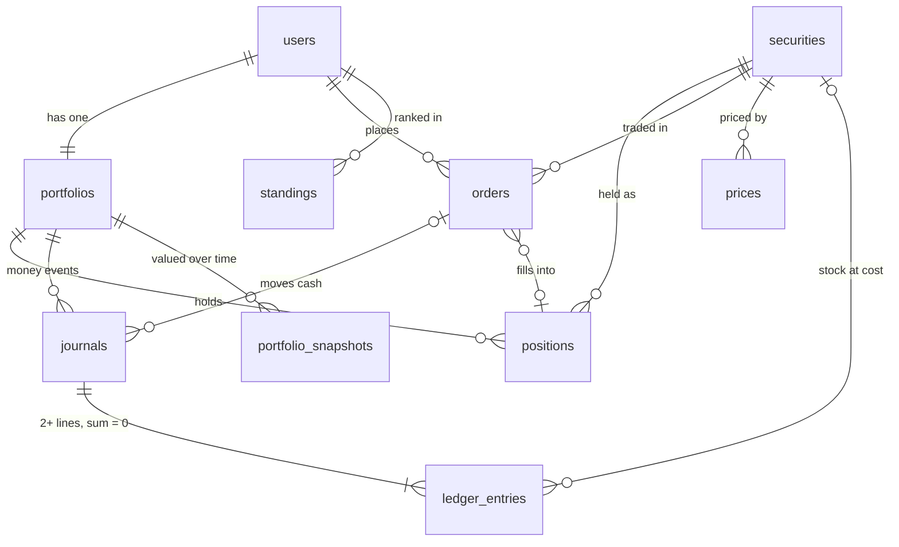

# Database schema

The current Postgres schema of the app's database: every table, its fields, its indexes, and how the tables connect.

- **Source of truth:** the migrations in [api/migrations/](../api/migrations/). This file describes the schema after all of them have run.
- **Keep it in sync:** every new migration updates this file in the same commit.
- **Last migration covered:** `20261109140000000_engine.sql`

## Relationships

`usd_ils`, `world_clock`, `market_closures` and `market_events` stand alone and have no foreign keys. `holdings` is a view of the open `positions`. `market_closures.market` matches `securities.market` by value (TASE or US).

| From | To | Type | On delete |
|------|----|------|-----------|
| `portfolios.uid` | `users.uid` | 1 to 1 | CASCADE |
| `positions.uid` | `portfolios.uid` | many to 1 | CASCADE |
| `positions.symbol` | `securities.symbol` | many to 1 | blocked |
| `journals.uid` | `portfolios.uid` | many to 1 | CASCADE |
| `journals.order_id` | `orders.id` | many to 1 | CASCADE |
| `ledger_entries.(journal_id, uid)` | `journals.(id, uid)` | many to 1 | CASCADE. The same player as its journal |
| `ledger_entries.symbol` | `securities.symbol` | many to 1 | blocked |
| `orders.uid` | `users.uid` | many to 1 | CASCADE |
| `orders.symbol` | `securities.symbol` | many to 1 | blocked |
| `orders.position_id` | `positions.id` | many to 1 | blocked |
| `portfolio_snapshots.uid` | `portfolios.uid` | many to 1 | CASCADE |
| `standings.uid` | `users.uid` | many to 1 | CASCADE |
| `prices.symbol` | `securities.symbol` | many to 1 | blocked |

Deleting a user removes their portfolio, positions, ledger, orders, snapshots and standings (the ledger allows a delete only as part of that cascade). A security can't be deleted while anything still refers to it.

## Tables

### `users`
One row per player. Firebase Auth owns the login; this row owns the app data.

| Field | Type | Null | Default | Notes |
|-------|------|------|---------|-------|
| `uid` | TEXT | no | | **PK.** The Firebase Auth uid (the JWT's `sub`) |
| `email` | TEXT | no | | Copied from the verified token on every login |
| `roles` | TEXT[] | no | `'{user}'` | Non-empty, only `admin` / `user`. Changed only with SQL |
| `theme` | TEXT | no | `'dark'` | `dark` or `light` (D-007) |
| `created_at` | TIMESTAMPTZ | no | `now()` | |
| `display_name` | TEXT | yes | | Shown on the leaderboard. Never the email |
| `chart_settings` | JSONB | no | `'{}'` | Chart type, colors, indicators. Written only by `PATCH /me/chart-settings` |

### `securities`
The securities in the game.

| Field | Type | Null | Default | Notes |
|-------|------|------|---------|-------|
| `symbol` | TEXT | no | | **PK.** Game ticker: `TEVA`, `NVDA` |
| `name_he` | TEXT | no | | Hebrew name shown in the app |
| `name_en` | TEXT | yes | | English name |
| `market` | TEXT | no | | `TASE` or `US`. Decides the trading hours |
| `exchange` | TEXT | no | | `TASE`, `NASDAQ` or `NYSE` |
| `currency` | TEXT | no | | `ILS` or `USD`. TASE prices are stored in ₪, not agorot |
| `yahoo_symbol` | TEXT | yes | | **Unique.** `TEVA.TA`, `BRK-B`. Used by the chart (D-012). NULL = no chart |

### `prices`
One row per security per trading day, in the security's currency.

| Field | Type | Null | Default | Notes |
|-------|------|------|---------|-------|
| `symbol` | TEXT | no | | **PK part.** FK → `securities.symbol` |
| `day` | DATE | no | | **PK part.** Trading day, in the exchange's time zone |
| `open` | NUMERIC(14,4) | no | | > 0 |
| `close` | NUMERIC(14,4) | no | | > 0 |

### `usd_ils`
The USD/ILS rate per day (₪ per $1).

| Field | Type | Null | Default | Notes |
|-------|------|------|---------|-------|
| `day` | DATE | no | | **PK** |
| `open` | NUMERIC(10,4) | no | | > 0 |
| `close` | NUMERIC(10,4) | no | | > 0 |

### `world_clock`
The one shared game clock. At most one row; no row means the world hasn't started.

| Field | Type | Null | Default | Notes |
|-------|------|------|---------|-------|
| `id` | BOOLEAN | no | `TRUE` | **PK.** Must be TRUE, which allows only one row |
| `now_at` | TIMESTAMPTZ | no | | The world time when the clock was last set. While `running`, the current world time is `now_at` + (real now − `real_at`), skipping days when neither market opens (D-017) |
| `real_at` | TIMESTAMPTZ | no | `now()` | The real time when `now_at` was set |
| `running` | BOOLEAN | no | `FALSE` | TRUE = the clock runs at real speed |
| `ends_at` | TIMESTAMPTZ | yes | | The clock never passes it: one minute before the first open with no prices. Set by `npm run seed:world` |

### `market_closures`
Every Monday-to-Friday on which a market is closed (D-016). Weekends are a rule in code and have no rows. Filled from `api/src/world/closures.ts` by `npm run seed:world`, which stops if the list doesn't match the prices.

| Field | Type | Null | Default | Notes |
|-------|------|------|---------|-------|
| `market` | TEXT | no | | **PK part.** `TASE` or `US` |
| `day` | DATE | no | | **PK part.** Monday to Friday only (CHECK) |
| `reason_he` | TEXT | no | | Shown in the app: `פסח` |
| `reason_en` | TEXT | no | | `Passover` |

### `portfolios`
One per player, created with the user row on first login (D-008), together with a `start` journal for the starting cash. Every total is a stored column, written in the same transaction as the ledger (D-019); screens never add money up.

| Field | Type | Null | Default | Notes |
|-------|------|------|---------|-------|
| `uid` | TEXT | no | | **PK.** FK → `users.uid` |
| `cash` | NUMERIC(16,4) | no | `1000000` | All cash, ≥ 0. Equals ledger `cash_free` + `cash_locked` |
| `reserved_cash` | NUMERIC(16,2) | no | `0` | Locked by pending buys. Between 0 and `cash` (no leverage). Equals ledger `cash_locked` |
| `available_cash` | NUMERIC(16,4) | no | generated | `cash − reserved_cash`, stored |
| `holdings_value` | NUMERIC(16,2) | no | `0` | Sum of open positions' `market_value_ils` at the last mark, ≥ 0 |
| `equity` | NUMERIC(16,4) | no | generated | `cash + holdings_value`, stored. The player's value (AUM) |
| `realized_pnl` | NUMERIC(16,2) | no | `0` | Total from sales. Equals −(ledger `realized_pnl`) |
| `unrealized_pnl` | NUMERIC(16,2) | no | `0` | Sum of open positions' paper gain |
| `marked_at` | TIMESTAMPTZ | yes | | World time of the last valuation |
| `last_event_at` | TIMESTAMPTZ | yes | | The last market event applied to this player. The retry guard: an update applies only when this is older than the event (D-021) |
| `week_start` | DATE | yes | | Monday of the week the running totals belong to. Older than the current week = not touched this week (lazy reset, D-024) |
| `week_start_value` | NUMERIC(16,2) | yes | | Value when the week started for this player |
| `peak_value` | NUMERIC(16,2) | yes | | Highest value this week |
| `max_drawdown_pct` | NUMERIC(10,4) | no | `0` | Largest drop from the peak this week, ≥ 0 |

### `positions`
Every position a player ever held (D-019). A buy from 0 units opens a row; at 0 units it is closed and kept as history. Replaces the `holdings` table.

| Field | Type | Null | Default | Notes |
|-------|------|------|---------|-------|
| `id` | BIGINT | no | identity | **PK** |
| `uid` | TEXT | no | | FK → `portfolios.uid` |
| `symbol` | TEXT | no | | FK → `securities.symbol` |
| `status` | TEXT | no | `'open'` | `open` (units > 0, no `closed_at`) or `closed` (0 units, `closed_at` set) |
| `units` | NUMERIC(24,8) | no | | ≥ 0 |
| `reserved_units` | NUMERIC(24,8) | no | `0` | Locked by pending sells. Between 0 and `units` (no short selling) |
| `avg_cost_ils` | NUMERIC(20,8) | no | `0` | ₪ paid per unit, on average (average cost, D-019) |
| `cost_basis_ils` | NUMERIC(16,2) | no | `0` | ₪ paid for the units still held. Equals ledger `stock_cost` for the symbol |
| `realized_pnl_ils` | NUMERIC(16,2) | no | `0` | Gain from sales of this position |
| `last_price` | NUMERIC(14,4) | yes | | The mark, in the security's currency |
| `last_fx` | NUMERIC(10,4) | yes | | USD/ILS used for the mark (US only) |
| `market_value_ils` | NUMERIC(16,2) | yes | | `units × last_price × last_fx` |
| `unrealized_pnl_ils` | NUMERIC(16,2) | yes | | `market_value_ils − cost_basis_ils` |
| `marked_at` | TIMESTAMPTZ | yes | | World time of the mark |
| `opened_at` | TIMESTAMPTZ | yes | | World time |
| `closed_at` | TIMESTAMPTZ | yes | | World time |

`holdings` is now a **view**: `SELECT uid, symbol, units FROM positions WHERE status = 'open'`.

### `journals`
One row per money event (D-019): `start`, `reserve`, `release`, `buy`, `sell` or `reversal`. Its `ledger_entries` must add up to exactly 0, checked at commit by a deferred trigger. Append-only: a trigger refuses UPDATE and DELETE (except the cascade when a whole player is deleted).

| Field | Type | Null | Default | Notes |
|-------|------|------|---------|-------|
| `id` | BIGINT | no | identity | **PK.** Also UNIQUE with `uid`, so entries can require the same player |
| `uid` | TEXT | no | | FK → `portfolios.uid` |
| `kind` | TEXT | no | | See above. Every kind except `start` and `reversal` needs an `order_id` |
| `order_id` | BIGINT | yes | | FK → `orders.id` |
| `world_at` | TIMESTAMPTZ | yes | | World time. NULL for the start cash given on sign-up |
| `created_at` | TIMESTAMPTZ | no | `now()` | Real time |

### `ledger_entries`
The lines of each journal. Append-only, like `journals`. Sign rule: + is what the player has (cash, stock at cost), − is where it came from (capital, gains). A ₪100 gain is −100 on `realized_pnl`.

| Field | Type | Null | Default | Notes |
|-------|------|------|---------|-------|
| `id` | BIGINT | no | identity | **PK** |
| `journal_id` | BIGINT | no | | FK (with `uid`) → `journals` |
| `uid` | TEXT | no | | Must match the journal's player |
| `account` | TEXT | no | | `cash_free`, `cash_locked`, `stock_cost`, `realized_pnl` or `capital` |
| `symbol` | TEXT | yes | | FK → `securities.symbol`. Set exactly when `account = 'stock_cost'` |
| `amount` | NUMERIC(16,2) | no | | Signed ₪, never 0 |

### `orders`
Every order ever sent, for all players (D-004).

| Field | Type | Null | Default | Notes |
|-------|------|------|---------|-------|
| `id` | BIGINT | no | identity | **PK** |
| `uid` | TEXT | no | | FK → `users.uid` |
| `symbol` | TEXT | no | | FK → `securities.symbol` |
| `side` | TEXT | no | | `buy` or `sell` |
| `amount_ils` | NUMERIC(16,2) | yes | | > 0. Buys only: the ₪ to spend (D-018) |
| `units` | NUMERIC(24,8) | yes | | > 0. Sells only: the units to sell (D-018). A CHECK makes buys carry only `amount_ils` and sells only `units` |
| `status` | TEXT | no | `'pending'` | `pending`, `executed` or `rejected` |
| `placed_at` | TIMESTAMPTZ | no | | World time the order was sent |
| `executes_at` | TIMESTAMPTZ | no | | World time it will run |
| `price_type` | TEXT | no | | `open` or `close` |
| `reject_reason` | TEXT | yes | | Set exactly when `status = 'rejected'` |
| `created_at` | TIMESTAMPTZ | no | `now()` | Real time, for debugging |
| `client_order_id` | TEXT | yes | | From the app. Unique per player, so a retried request can't make a second order |
| `fill_price` | NUMERIC(14,4) | yes | | The execution price, in the security's currency |
| `fx_rate` | NUMERIC(10,4) | yes | | USD/ILS used (US only) |
| `filled_units` | NUMERIC(24,8) | yes | | Units bought or sold |
| `filled_ils` | NUMERIC(16,2) | yes | | ₪ paid or received |
| `realized_pnl_ils` | NUMERIC(16,2) | yes | | Sells only: gain at average cost |
| `position_id` | BIGINT | yes | | FK → `positions.id`: the position it opened or changed |
| `executed_at` | TIMESTAMPTZ | yes | | World time. A CHECK requires all fill columns exactly when `status = 'executed'` |

### `market_events`
The runner's event log (D-021): one row per open or close it processes. Status goes `pending` → `orders_done` (the event's prices are in effect) → `done`. The admin page reads the counts.

| Field | Type | Null | Default | Notes |
|-------|------|------|---------|-------|
| `id` | BIGINT | no | identity | **PK** |
| `market` | TEXT | no | | `TASE` or `US`. **Unique** with `kind` and `day` |
| `kind` | TEXT | no | | `open` or `close` |
| `day` | DATE | no | | Israel calendar date of the session |
| `at` | TIMESTAMPTZ | no | | World time of the open or close |
| `status` | TEXT | no | `'pending'` | `pending`, `orders_done` or `done` |
| `started_at` | TIMESTAMPTZ | yes | | Real time |
| `finished_at` | TIMESTAMPTZ | yes | | Real time |
| `orders_executed` | INTEGER | no | `0` | |
| `orders_rejected` | INTEGER | no | `0` | |
| `players_updated` | INTEGER | no | `0` | |
| `duration_ms` | INTEGER | yes | | |
| `ledger_balanced` | BOOLEAN | yes | | The check after the event (D-019) |
| `median_value` | NUMERIC(16,2) | yes | | The median player line (D-024) |
| `median_return_pct` | NUMERIC(10,4) | yes | | |

### `portfolio_snapshots`
Chart history: at most one row per player per trading day, written at that day's last event and only when the value changed (D-024). The value at time t is the latest row at or before t. Weekly return and drawdown come from the running totals on `portfolios`, not from here.

| Field | Type | Null | Default | Notes |
|-------|------|------|---------|-------|
| `uid` | TEXT | no | | **PK part.** FK → `portfolios.uid` |
| `at` | TIMESTAMPTZ | no | | **PK part.** World time |
| `value_ils` | NUMERIC(16,2) | no | | ≥ 0 |

### `standings`
The weekly competition as of the end of each game day (D-006).

| Field | Type | Null | Default | Notes |
|-------|------|------|---------|-------|
| `day` | DATE | no | | **PK part.** A Mon to Fri world-clock day |
| `uid` | TEXT | no | | **PK part.** FK → `users.uid` |
| `return_pct` | NUMERIC(10,4) | no | | Week return so far. `2.35` = +2.35% |
| `max_drawdown_pct` | NUMERIC(10,4) | no | | ≥ 0 |
| `return_rank` | NUMERIC(6,2) | no | | 0 to 100 |
| `stability_rank` | NUMERIC(6,2) | no | | 0 to 100 |
| `score` | NUMERIC(6,2) | no | | 0 to 100 |
| `rank` | INTEGER | no | | > 0 |

## Indexes

Every primary key and UNIQUE column has its own index. The other indexes exist for specific queries.

| Table | Index | Columns | Kind | Used for |
|-------|-------|---------|------|----------|
| `users` | `users_pkey` | `uid` | PK | |
| `securities` | `securities_pkey` | `symbol` | PK | |
| `securities` | `securities_yahoo_symbol_key` | `yahoo_symbol` | unique | Chart lookup by Yahoo symbol |
| `prices` | `prices_pkey` | `symbol, day` | PK | Price of a security on a day |
| `usd_ils` | `usd_ils_pkey` | `day` | PK | |
| `world_clock` | `world_clock_pkey` | `id` | PK | |
| `market_closures` | `market_closures_pkey` | `market, day` | PK | Is this market closed on this day |
| `portfolios` | `portfolios_pkey` | `uid` | PK | |
| `positions` | `positions_pkey` | `id` | PK | |
| `positions` | `positions_open_idx` | `uid, symbol` WHERE `status = 'open'` | partial, unique | One open position per player per stock; paging affected players by uid |
| `positions` | `positions_uid_idx` | `uid` | | A player's positions, open and closed |
| `journals` | `journals_pkey` | `id` | PK | |
| `journals` | `journals_id_uid_key` | `id, uid` | unique | Target of the entries' same-player foreign key |
| `journals` | `journals_uid_idx` | `uid, id` | | A player's money history |
| `journals` | `journals_order_idx` | `order_id` WHERE `order_id IS NOT NULL` | partial | The journals of an order |
| `ledger_entries` | `ledger_entries_pkey` | `id` | PK | |
| `ledger_entries` | `ledger_entries_account_idx` | `uid, account, symbol` | | Account balances for the check after each event |
| `ledger_entries` | `ledger_entries_journal_idx` | `journal_id` | | The balance trigger: a journal's lines |
| `orders` | `orders_pkey` | `id` | PK | |
| `orders` | `orders_pending_idx` | `executes_at` WHERE `status = 'pending'` | partial | Finding orders due to execute |
| `orders` | `orders_uid_idx` | `uid, placed_at DESC` | | A player's order history, newest first |
| `orders` | `orders_client_order_idx` | `uid, client_order_id` WHERE `client_order_id IS NOT NULL` | partial, unique | A retried request can't make a second order |
| `market_events` | `market_events_pkey` | `id` | PK | |
| `market_events` | `market_events_market_kind_day_key` | `market, kind, day` | unique | One row per open or close |
| `market_events` | `market_events_at_idx` | `at` | | The latest events, the admin page |
| `market_events` | `market_events_unfinished_idx` | `at` WHERE `status <> 'done'` | partial | Where the runner resumes after a crash |
| `portfolio_snapshots` | `portfolio_snapshots_pkey` | `uid, at` | PK | A player's value chart |
| `portfolio_snapshots` | `portfolio_snapshots_at_idx` | `at` | | All players' values at a given time |
| `standings` | `standings_pkey` | `day, uid` | PK | |
| `standings` | `standings_day_rank_idx` | `day, rank` | | The leaderboard for a day, in rank order |

## Local price database (not the app schema)

`db/init/001_prices.sql` creates a separate local database that the scraper fills with real Yahoo prices (D-002). The app's `prices` and `usd_ils` tables are loaded from it.

| Table | Fields | Notes |
|-------|--------|-------|
| `securities` | `symbol` (PK, Yahoo symbol), `name`, `market` (`TASE`/`US`/`FX`), `currency` | `ILA` = agorot: divide by 100 for ₪ |
| `daily_prices` | `symbol` (FK → `securities`), `day`, `open`, `close`, `fetched_at` | PK `(symbol, day)` |
