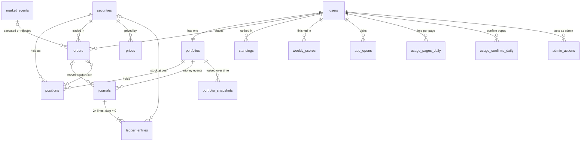

# Database schema

The current Postgres schema of the app's database: every table, its fields, its indexes, and how the tables connect.

- **Source of truth:** the migrations in [api/migrations/](../api/migrations/). This file describes the schema after all of them have run.
- **Keep it in sync:** every new migration updates this file in the same commit.
- **Last migration covered:** `20261111190015612_usage.sql`

## Relationships

`usd_ils`, `world_clock` and `market_closures` stand alone and have no foreign keys. `market_events` has none of its own; `orders.event_id` points to it. `holdings` is a view of the open `positions`. `market_closures.market` matches `securities.market` by value (TASE or US).

| From | To | Type | On delete |
|------|----|------|-----------|
| `portfolios.uid` | `users.uid` | 1 to 1 | CASCADE |
| `positions.uid` | `portfolios.uid` | many to 1 | CASCADE |
| `positions.symbol` | `securities.symbol` | many to 1 | blocked |
| `journals.uid` | `portfolios.uid` | many to 1 | CASCADE |
| `journals.order_id` | `orders.id` | many to 1 | CASCADE |
| `ledger_entries.(journal_id, uid)` | `journals.(id, uid)` | many to 1 | CASCADE. The same player as its journal |
| `ledger_entries.symbol` | `securities.symbol` | many to 1 | blocked |
| `orders.uid` | `users.uid` | many to 1 | CASCADE |
| `orders.symbol` | `securities.symbol` | many to 1 | blocked |
| `orders.position_id` | `positions.id` | many to 1 | blocked |
| `orders.event_id` | `market_events.id` | many to 1 | blocked |
| `portfolio_snapshots.uid` | `portfolios.uid` | many to 1 | CASCADE |
| `standings.uid` | `users.uid` | many to 1 | CASCADE |
| `weekly_scores.uid` | `users.uid` | many to 1 | CASCADE |
| `app_opens.uid` | `users.uid` | many to 1 | CASCADE |
| `usage_pages_daily.uid` | `users.uid` | many to 1 | CASCADE |
| `usage_confirms_daily.uid` | `users.uid` | many to 1 | CASCADE |
| `admin_actions.uid` | `users.uid` | many to 1 | CASCADE |
| `prices.symbol` | `securities.symbol` | many to 1 | blocked |

Deleting a user removes their portfolio, positions, ledger, orders, snapshots, standings, weekly scores, visits and usage totals (the ledger allows a delete only as part of that cascade). A security can't be deleted while anything still refers to it, and neither can a market event that orders point to.

## Tables

### `users`
One row per player. Firebase Auth owns the login; this row owns the app data.

| Field | Type | Null | Default | Notes |
|-------|------|------|---------|-------|
| `uid` | TEXT | no | | **PK.** The Firebase Auth uid (the JWT's `sub`) |
| `email` | TEXT | no | | Copied from the verified token on every login |
| `roles` | TEXT[] | no | `'{user}'` | Non-empty, only `admin` / `user`. Changed only with SQL |
| `theme` | TEXT | no | `'dark'` | `dark` or `light` (D-007) |
| `created_at` | TIMESTAMPTZ | no | `now()` | |
| `display_name` | TEXT | yes | | Shown on the leaderboard. Never the email |
| `chart_settings` | JSONB | no | `'{}'` | Chart type, colors, indicators. Written only by `PATCH /me/chart-settings` |
| `last_seen_at` | TIMESTAMPTZ | yes | | Real time of the app's last check-in (D-026). Online = within 2 minutes. NULL = never checked in. Written only by `POST /me/seen` |

### `app_opens`
One row per visit (D-026). A check-in after more than 30 minutes away, or the very first one, starts a visit. The server decides, never the app. Real time.

| Field | Type | Null | Default | Notes |
|-------|------|------|---------|-------|
| `id` | BIGINT | no | identity | **PK** |
| `uid` | TEXT | no | | FK → `users.uid` |
| `at` | TIMESTAMPTZ | no | `now()` | When the visit started |

### `usage_pages_daily`
Time and views per player per page per real Israel day (D-036), for the admin monitoring page. Written only by `POST /me/seen`: the check-in's optional usage report is capped by the server and added to the day's row (`INSERT … ON CONFLICT … DO UPDATE SET views = views + …, ms = ms + …`). Daily totals, not an event log: it grows with players × pages per day, never with clicks. A row exists only when the player had a view or some time on that page that day.

| Field | Type | Null | Default | Notes |
|-------|------|------|---------|-------|
| `day` | DATE | no | | **PK part.** Real Israel date, `(now() AT TIME ZONE 'Asia/Jerusalem')::date`, computed by Postgres on write |
| `page` | TEXT | no | | **PK part.** `dashboard`, `trade`, `journal` or `leaderboard`. Checked in code (`USAGE_PAGES` in `api/src/usage.ts`), not by a CHECK, so a new page needs no migration; the reads skip any other name |
| `uid` | TEXT | no | | **PK part.** FK → `users.uid` |
| `views` | INT | no | `0` | ≥ 0. Times the page was opened. At most 50 per report |
| `ms` | BIGINT | no | `0` | ≥ 0. Time on the page while the app was visible and someone used it in the last 5 minutes. At most 120,000 per report, all pages together |

### `usage_confirms_daily`
The trade screen's confirm popup per player per real Israel day (D-036): how often it opened, and how often it closed without sending (backed out). Written only by `POST /me/seen`, like `usage_pages_daily`. Orders actually sent are counted from `orders`, never from here.

| Field | Type | Null | Default | Notes |
|-------|------|------|---------|-------|
| `day` | DATE | no | | **PK part.** Real Israel date, computed by Postgres on write |
| `uid` | TEXT | no | | **PK part.** FK → `users.uid` |
| `opened` | INT | no | `0` | ≥ 0. At most 50 per report |
| `backed` | INT | no | `0` | ≥ 0. Closed without a send by the player's choice. At most 50 per report. Can be above `opened` on a day: a popup opened before midnight can be backed out of after it |

### `admin_actions`
The admin action log (D-027). One row per admin clock action, written in the same transaction as the action, so a row exists exactly when the action happened. Append-only.

| Field | Type | Null | Default | Notes |
|-------|------|------|---------|-------|
| `id` | BIGINT | no | identity | **PK** |
| `uid` | TEXT | no | | FK → `users.uid`. The admin who did it |
| `action` | TEXT | no | | `clock_to_close`, `clock_to_open`, `clock_start` or `clock_stop` |
| `world_from` | TIMESTAMPTZ | yes | | World time before the action |
| `world_to` | TIMESTAMPTZ | yes | | World time after it |
| `detail` | JSONB | no | `'{}'` | For example `{"events": 2, "ordersExecuted": 14}` |
| `at` | TIMESTAMPTZ | no | `now()` | Real time |

### `securities`
The securities in the game.

| Field | Type | Null | Default | Notes |
|-------|------|------|---------|-------|
| `symbol` | TEXT | no | | **PK.** Game ticker: `TEVA`, `NVDA` |
| `name_he` | TEXT | no | | Hebrew name shown in the app |
| `name_en` | TEXT | yes | | English name |
| `market` | TEXT | no | | `TASE` or `US`. Decides the trading hours |
| `exchange` | TEXT | no | | `TASE`, `NASDAQ` or `NYSE` |
| `currency` | TEXT | no | | `ILS` or `USD`. TASE prices are stored in ₪, not agorot |
| `yahoo_symbol` | TEXT | yes | | **Unique.** `TEVA.TA`, `BRK-B`. Used by the chart (D-012). NULL = no chart |

### `prices`
One row per security per trading day, in the security's currency.

| Field | Type | Null | Default | Notes |
|-------|------|------|---------|-------|
| `symbol` | TEXT | no | | **PK part.** FK → `securities.symbol` |
| `day` | DATE | no | | **PK part.** Trading day, in the exchange's time zone |
| `open` | NUMERIC(14,4) | no | | > 0 |
| `close` | NUMERIC(14,4) | no | | > 0 |

### `usd_ils`
The USD/ILS rate per day (₪ per $1).

| Field | Type | Null | Default | Notes |
|-------|------|------|---------|-------|
| `day` | DATE | no | | **PK** |
| `open` | NUMERIC(10,4) | no | | > 0 |
| `close` | NUMERIC(10,4) | no | | > 0 |

### `world_clock`
The one shared game clock. At most one row; no row means the world hasn't started.

| Field | Type | Null | Default | Notes |
|-------|------|------|---------|-------|
| `id` | BOOLEAN | no | `TRUE` | **PK.** Must be TRUE, which allows only one row |
| `now_at` | TIMESTAMPTZ | no | | The world time when the clock was last set. While `running`, the current world time is `now_at` + (real now − `real_at`), skipping days when neither market opens (D-017) |
| `real_at` | TIMESTAMPTZ | no | `now()` | The real time when `now_at` was set |
| `running` | BOOLEAN | no | `FALSE` | TRUE = the clock runs at real speed |
| `ends_at` | TIMESTAMPTZ | yes | | The clock never passes it: one minute before the first open with no prices. Set by `npm run seed:world` |
| `last_tick_at` | TIMESTAMPTZ | yes | | Real time of the ticker's last tick. It ticks every minute even when nothing is due, so the admin page shows red when it stops. NULL = never ticked |
| `events_through` | TIMESTAMPTZ | yes | | World time of the latest event the runner has **started**; every event at or before it has started or finished. The effective "now" is never before it (`worldNow` in `api/src/game/clock.ts`), so an order sent during an admin jump runs after the event already running. NULL = no event started yet |

The effective world time everyone uses (screens, order sending, the runner) is the larger of the clock time above and `events_through`.

### `market_closures`
Every Monday-to-Friday on which a market is closed (D-016). Weekends are a rule in code and have no rows. Filled from `api/src/world/closures.ts` by `npm run seed:world`, which stops if the list doesn't match the prices.

| Field | Type | Null | Default | Notes |
|-------|------|------|---------|-------|
| `market` | TEXT | no | | **PK part.** `TASE` or `US` |
| `day` | DATE | no | | **PK part.** Monday to Friday only (CHECK) |
| `reason_he` | TEXT | no | | Shown in the app: `פסח` |
| `reason_en` | TEXT | no | | `Passover` |

### `portfolios`
One per player, created with the user row on first login (D-008), together with a `start` journal for the starting cash. Every total is a stored column, written in the same transaction as the ledger (D-019); screens never add money up.

| Field | Type | Null | Default | Notes |
|-------|------|------|---------|-------|
| `uid` | TEXT | no | | **PK.** FK → `users.uid` |
| `cash` | NUMERIC(16,4) | no | `1000000` | All cash, ≥ 0. Equals ledger `cash_free` + `cash_locked` |
| `reserved_cash` | NUMERIC(16,2) | no | `0` | Locked by pending buys. Between 0 and `cash` (no leverage). Equals ledger `cash_locked` |
| `available_cash` | NUMERIC(16,4) | no | generated | `cash − reserved_cash`, stored |
| `holdings_value` | NUMERIC(16,2) | no | `0` | Sum of open positions' `market_value_ils` at the last mark, ≥ 0 |
| `equity` | NUMERIC(16,4) | no | generated | `cash + holdings_value`, stored. The player's value (AUM) |
| `realized_pnl` | NUMERIC(16,2) | no | `0` | Total from sales. Equals −(ledger `realized_pnl`) |
| `unrealized_pnl` | NUMERIC(16,2) | no | `0` | Sum of open positions' paper gain |
| `marked_at` | TIMESTAMPTZ | yes | | World time of the last valuation |
| `last_event_at` | TIMESTAMPTZ | yes | | The last market event applied to this player. The retry guard: an update applies only when this is older than the event (D-021) |
| `week_start` | DATE | yes | | Monday of the week the running totals belong to. Older than the current week = not touched this week (lazy reset, D-024) |
| `week_start_value` | NUMERIC(16,2) | yes | | Value when the week started for this player |
| `peak_value` | NUMERIC(16,2) | yes | | Highest value this week |
| `max_drawdown_pct` | NUMERIC(10,4) | no | `0` | Largest drop from the peak this week, ≥ 0 |

### `positions`
Every position a player ever held (D-019). A buy from 0 units opens a row; at 0 units it is closed and kept as history. Replaces the `holdings` table.

| Field | Type | Null | Default | Notes |
|-------|------|------|---------|-------|
| `id` | BIGINT | no | identity | **PK** |
| `uid` | TEXT | no | | FK → `portfolios.uid` |
| `symbol` | TEXT | no | | FK → `securities.symbol` |
| `status` | TEXT | no | `'open'` | `open` (units > 0, no `closed_at`) or `closed` (0 units, `closed_at` set) |
| `units` | NUMERIC(24,8) | no | | ≥ 0 |
| `reserved_units` | NUMERIC(24,8) | no | `0` | Locked by pending sells. Between 0 and `units` (no short selling) |
| `avg_cost_ils` | NUMERIC(20,8) | no | `0` | ₪ paid per unit, on average (average cost, D-019) |
| `cost_basis_ils` | NUMERIC(16,2) | no | `0` | ₪ paid for the units still held. Equals ledger `stock_cost` for the symbol |
| `realized_pnl_ils` | NUMERIC(16,2) | no | `0` | Gain from sales of this position |
| `last_price` | NUMERIC(14,4) | yes | | The mark, in the security's currency |
| `last_fx` | NUMERIC(10,4) | yes | | USD/ILS used for the mark (US only) |
| `market_value_ils` | NUMERIC(16,2) | yes | | `units × last_price × last_fx` |
| `unrealized_pnl_ils` | NUMERIC(16,2) | yes | | `market_value_ils − cost_basis_ils` |
| `marked_at` | TIMESTAMPTZ | yes | | World time of the mark |
| `opened_at` | TIMESTAMPTZ | yes | | World time |
| `closed_at` | TIMESTAMPTZ | yes | | World time |

`holdings` is now a **view**: `SELECT uid, symbol, units FROM positions WHERE status = 'open'`.

### `journals`
One row per money event (D-019): `start`, `reserve`, `release`, `buy`, `sell` or `reversal`. Its `ledger_entries` must add up to exactly 0, checked at commit by a deferred trigger. Append-only: a trigger refuses UPDATE and DELETE (except the cascade when a whole player is deleted).

| Field | Type | Null | Default | Notes |
|-------|------|------|---------|-------|
| `id` | BIGINT | no | identity | **PK.** Also UNIQUE with `uid`, so entries can require the same player |
| `uid` | TEXT | no | | FK → `portfolios.uid` |
| `kind` | TEXT | no | | See above. Every kind except `start` and `reversal` needs an `order_id` |
| `order_id` | BIGINT | yes | | FK → `orders.id` |
| `world_at` | TIMESTAMPTZ | yes | | World time. NULL for the start cash given on sign-up |
| `created_at` | TIMESTAMPTZ | no | `now()` | Real time |

### `ledger_entries`
The lines of each journal. Append-only, like `journals`. Sign rule: + is what the player has (cash, stock at cost), − is where it came from (capital, gains). A ₪100 gain is −100 on `realized_pnl`.

| Field | Type | Null | Default | Notes |
|-------|------|------|---------|-------|
| `id` | BIGINT | no | identity | **PK** |
| `journal_id` | BIGINT | no | | FK (with `uid`) → `journals` |
| `uid` | TEXT | no | | Must match the journal's player |
| `account` | TEXT | no | | `cash_free`, `cash_locked`, `stock_cost`, `realized_pnl` or `capital` |
| `symbol` | TEXT | yes | | FK → `securities.symbol`. Set exactly when `account = 'stock_cost'` |
| `amount` | NUMERIC(16,2) | no | | Signed ₪, never 0 |

### `orders`
Every order ever sent, for all players (D-004).

| Field | Type | Null | Default | Notes |
|-------|------|------|---------|-------|
| `id` | BIGINT | no | identity | **PK** |
| `uid` | TEXT | no | | FK → `users.uid` |
| `symbol` | TEXT | no | | FK → `securities.symbol` |
| `side` | TEXT | no | | `buy` or `sell` |
| `amount_ils` | NUMERIC(16,2) | yes | | > 0. Buys only: the ₪ to spend (D-018) |
| `units` | NUMERIC(24,8) | yes | | > 0. Sells only: the units to sell (D-018). A CHECK makes buys carry only `amount_ils` and sells only `units` |
| `status` | TEXT | no | `'pending'` | `pending`, `executed` or `rejected` |
| `placed_at` | TIMESTAMPTZ | no | | World time the order was sent |
| `executes_at` | TIMESTAMPTZ | no | | World time it will run |
| `price_type` | TEXT | no | | `open` or `close` |
| `reject_reason` | TEXT | yes | | Set exactly when `status = 'rejected'`. In Hebrew, shown to the player |
| `created_at` | TIMESTAMPTZ | no | `now()` | Real time. The rate limit counts a player's orders by it, and the monitoring page counts orders sent per real Israel day by it (D-036) |
| `client_order_id` | TEXT | yes | | From the app. Unique per player, so a retried request can't make a second order |
| `fill_price` | NUMERIC(14,4) | yes | | The execution price, in the security's currency |
| `fx_rate` | NUMERIC(10,4) | yes | | USD/ILS used (US only) |
| `filled_units` | NUMERIC(24,8) | yes | | Units bought or sold |
| `filled_ils` | NUMERIC(16,2) | yes | | ₪ paid or received |
| `realized_pnl_ils` | NUMERIC(16,2) | yes | | Sells only: gain at average cost |
| `position_id` | BIGINT | yes | | FK → `positions.id`: the position it opened or changed |
| `executed_at` | TIMESTAMPTZ | yes | | World time. A CHECK requires all fill columns exactly when `status = 'executed'` |
| `reject_code` | TEXT | yes | | Why the runner rejected it, so the app can show English: `NO_PRICE`, `INSUFFICIENT_CASH`, `OVER_LIMIT` or `INSUFFICIENT_UNITS`. Only on a rejected order (CHECK). Refusals when sending are answered with an error and never stored |
| `event_id` | BIGINT | yes | | FK → `market_events.id`: the event that executed or rejected it. A CHECK makes it NULL exactly while `status = 'pending'` |
| `notified_at` | TIMESTAMPTZ | yes | | Real time the player saw the rejection toast (D-023). Only on a rejected order (CHECK). NULL = not seen yet |

### `market_events`
The runner's event log (D-021): one row per open or close it processes. Status goes `pending` → `orders_done` (the event's prices are in effect) → `done`. The admin page reads the counts.

| Field | Type | Null | Default | Notes |
|-------|------|------|---------|-------|
| `id` | BIGINT | no | identity | **PK** |
| `market` | TEXT | no | | `TASE` or `US`. **Unique** with `kind` and `day` |
| `kind` | TEXT | no | | `open` or `close` |
| `day` | DATE | no | | Israel calendar date of the session |
| `at` | TIMESTAMPTZ | no | | World time of the open or close |
| `status` | TEXT | no | `'pending'` | `pending`, `orders_done` or `done` |
| `started_at` | TIMESTAMPTZ | yes | | Real time |
| `finished_at` | TIMESTAMPTZ | yes | | Real time |
| `orders_executed` | INTEGER | no | `0` | |
| `orders_rejected` | INTEGER | no | `0` | |
| `players_updated` | INTEGER | no | `0` | Players the runner's own pages re-valued (step 2). A player brought up to date by a read's catch-up (D-025) is not counted |
| `duration_ms` | INTEGER | yes | | |
| `ledger_balanced` | BOOLEAN | yes | | The ledger check (D-019, D-029), run in each order batch for that batch's players: `false` as soon as one batch finds a mismatch, `true` when the event is done with none. NULL = not done and nothing wrong found yet |
| `median_value` | NUMERIC(16,2) | yes | | The median player line (D-024) |
| `median_return_pct` | NUMERIC(10,4) | yes | | |

### `portfolio_snapshots`
Chart history: at most one row per player per trading day, written at that day's last event for every player an open or close re-valued that day (`last_event_at` on that day), whether or not the value moved (D-024, D-029). Cash-only players and players nothing touched that day get no row. The value at time t is the latest row at or before t. Weekly return and drawdown come from the running totals on `portfolios`, not from here.

| Field | Type | Null | Default | Notes |
|-------|------|------|---------|-------|
| `uid` | TEXT | no | | **PK part.** FK → `portfolios.uid` |
| `at` | TIMESTAMPTZ | no | | **PK part.** World time |
| `value_ils` | NUMERIC(16,2) | no | | ≥ 0 |

### `standings`
The live weekly board (D-032): one row per ranked player per scored day of the week, with that day's numbers and place. Written only by the runner's scoring step at every open and close (`scoreEvent` in `api/src/scoring.ts`, called from `finishEvent` in `api/src/runner.ts`; the rules in `api/src/game/score.ts`; D-034). The API only reads it (`api/src/leaderboard.ts`, for `GET /me/leaderboard` and the dashboard). `npm run seed:sample-board` fills it with made-up rows for development (D-033).

**Who has a row (D-034):** at an event of week W, every player whose `portfolios.week_start` is W (an open or close touched them this week: a stock held at it, or an order due at it) or who holds an open position now. A cash-only player nothing touched this week has no row.

| Field | Type | Null | Default | Notes |
|-------|------|------|---------|-------|
| `day` | DATE | no | | **PK part.** The scored day: a Mon to Fri world-clock date (Israel) |
| `uid` | TEXT | no | | **PK part.** FK → `users.uid` |
| `return_pct` | NUMERIC(10,4) | no | | Week return so far. `2.35` = +2.35%. 0 for a row whose `week_start` isn't this week |
| `max_drawdown_pct` | NUMERIC(10,4) | no | | ≥ 0. The largest drop from the week's peak so far |
| `return_rank` | NUMERIC(6,2) | no | | 0 to 100. 100 = the best return. 100 × (other ranked players with a return ≤ mine) ÷ (N − 1): ties share the higher percentile (D-034) |
| `stability_rank` | NUMERIC(6,2) | no | | 0 to 100. 100 = the smallest drawdown. 100 × (others with a drawdown ≥ mine) ÷ (N − 1) |
| `score` | NUMERIC(6,2) | no | | 0 to 100. 0.85 × `return_rank` + 0.15 × `stability_rank`, from these stored (rounded) ranks. All three rounded half away from zero |
| `rank` | INTEGER | no | | > 0. The place, 1..N: **unique per day** (`UNIQUE (day, rank)`) and the list order |

**One player per place.** `UNIQUE (day, rank)` (`standings_day_rank_key`) means no two players share a place on a day: equal scores are broken by % gain, then the smaller drawdown, then the earlier sign-up, never by a ₪ amount (D-032). It is `DEFERRABLE` (initially immediate): Postgres checks it at the end of each statement instead of row by row, so a single `UPDATE` that swaps two players' places works. Its index is also the read path: the top N, "around me" and the player count (`max(rank)`) are each one index range or probe, never a scan of the day.

**What Phase 4b must write** (the contract the leaderboard reads, D-032). Met since 11.11.2026 by the scoring step (D-034): see "How the scoring meets it" below.
- **One row per ranked player per scored day.** Who is ranked was 4b's decision: see "Who has a row" above. Mid-week joiners have a row from the event their first buy fills.
- **Ranks 1..N on each day: unique and without gaps.** The API counts the players as `max(rank)` of the day, never `count(*)`, and pages the table by rank ranges. A gap makes the count one too high and a page one row short.
- **`rank` is the list order** (score, then % gain, the smaller drawdown, the earlier sign-up). The API never sorts the rows itself.
- **A day appears whole.** The board shown is the latest day up to the world's today (`max(day)`), so a new day's rows must all be committed in one transaction, and a rewrite of a day too. Otherwise a reader can show a half-written day. The reader's side of this: each request reads the board in one read-only `REPEATABLE READ` snapshot (`inSnapshot` in `api/src/leaderboard.ts`), so a commit between two of its statements can't mix two rankings in one answer.
- **Keep every scored day of the current week**: the rank change (▲/▼) is "my place on the previous scored day of this week − my place now", and the row's daily scores come from the same rows.
- **Keep the closed week's standings until the next week's first scoring.** On the weekend, and on Monday before the week's first open, the board still shows the closed week from these rows. Older weeks can be deleted then (their final board is in `weekly_scores`).
- **Run `ANALYZE standings` after committing a new day** (and `ANALYZE weekly_scores` after a new week), in the same job. The table only ever holds about 10 distinct days, so the planner keeps every day as a most-common value, and a day it has no statistics for yet is estimated at 1 row. Until autoanalyze runs (up to a minute or more after the write, exactly when every open screen reloads), "my row" and "my days" become scans of the whole day: measured at 50,000 players, 5 to 16 ms per statement instead of 0.03 to 0.1 ms, and less than half the requests per second. `ANALYZE` samples about 30,000 rows and takes well under a second. `npm run seed:sample-board` does the same.
- **Upsert with `ON CONFLICT (day, uid)`, or delete and re-insert the day.** `standings_day_rank_key` is `DEFERRABLE`, and Postgres can't use a deferrable key as an `ON CONFLICT` arbiter: a bare `ON CONFLICT DO NOTHING`, or one that names `standings_day_rank_key`, raises an error. `ON CONFLICT (day, uid) DO UPDATE SET rank = EXCLUDED.rank, ...` works, swaps included.

**How the scoring meets it** (D-034, `api/src/scoring.ts`):
- **Delete and re-insert.** At every open and close the event's day is deleted and written again by one `INSERT … SELECT` with window functions. Places are `row_number()` by score, % return, the smaller drawdown, `users.created_at`, then `uid COLLATE "C"`, so they run 1..N with no gaps. A gap left by a deleted user in `standings` closes at the next event. The delete runs only when someone is ranked: with nobody ranked the day keeps what it holds (a development sample day, D-033), which can't be real rows, since within a week the ranked set only grows except through user deletes, and those cascade.
- **One transaction with the event's `done`.** The day's rows are written in the runner's finish transaction, with the median and `market_events.status = 'done'`. A crash before the commit leaves the event `orders_done`, and the re-run writes the day again.
- **The week's end.** At the week's last event (`isLastEventOfWeek` in `api/src/game/score.ts`), the same transaction copies the day to `weekly_scores`.
- **Pruning at the next week's first scoring.** The first scoring of a new week that ranks anyone first writes `weekly_scores` for any earlier week that has none, from its last scored day. It then deletes every day before the new week's Monday. A scoring that ranks nobody prunes nothing, so the closed week stays on the board.
- **`ANALYZE` after the commit of a new day.** `ANALYZE standings` (and `weekly_scores` when weekly rows were written) runs on the runner's connection after the commit, when the event wrote a day that had no rows before, or weekly rows. A rewrite of a day the planner already knows skips it: the statistics still hold, and `ANALYZE` cancels a running autovacuum of the table (after `deadlock_timeout`), so at every event of back-to-back events standings was never vacuumed. Autoanalyze still runs after rewrites. A failure is logged, not thrown.
- **The scoring locks the ranked players' `users` rows.** The foreign keys of `standings` and `weekly_scores` take `FOR KEY SHARE` on each ranked player's `users` row until the finish transaction commits. A plain `UPDATE` of a non-key column doesn't wait for it, but `SELECT … FOR UPDATE` does, so the check-in (`POST /me/seen`) locks `FOR NO KEY UPDATE` (D-026).

### `weekly_scores`
The final board of each closed week (D-032): one row per ranked player, a copy of the week's last `standings` day. Past weeks on the leaderboard read it, and a row for a week marks that week's board as final.

**Who writes it (D-034, `api/src/scoring.ts`):** the runner's scoring step, in the same transaction as the event's `done`:
- At the week's last event (no open or close left before next Monday 00:00 Israel time, or before `world_clock.ends_at`): the week's rows are deleted and the day's `standings` rows copied exactly.
- At any other event of the same week: the week's rows are deleted (normally there are none), so a final board written too early can't mark a live week as final.
- At the first scoring of a later week that ranks anyone: an earlier week with `standings` days but no rows here gets them, copied from its last scored day, before those days are deleted.

Once the next week has been scored, a week's rows don't change again, except that a deleted user's rows go with them (CASCADE).

| Field | Type | Null | Default | Notes |
|-------|------|------|---------|-------|
| `week_start` | DATE | no | | **PK part.** The week's Monday (Israel date). A CHECK refuses any other weekday |
| `uid` | TEXT | no | | **PK part.** FK → `users.uid` |
| `return_pct` | NUMERIC(10,4) | no | | The week's return. `2.35` = +2.35% |
| `max_drawdown_pct` | NUMERIC(10,4) | no | | ≥ 0 |
| `return_rank` | NUMERIC(6,2) | no | | 0 to 100 |
| `stability_rank` | NUMERIC(6,2) | no | | 0 to 100 |
| `score` | NUMERIC(6,2) | no | | 0 to 100 |
| `rank` | INTEGER | no | | > 0. The final place, 1..N: **unique per week** (`UNIQUE (week_start, rank)`) and the list order |

Written with the same rules as `standings`: ranks 1..N without gaps, `rank` = the list order, the player count = `max(rank)` of the week. A later user deletion leaves a gap here that is never closed (a closed week is never renumbered), so `max(rank)` stays the number of players the week closed with (D-032). Nothing reads a closed week by rank range today; a full past-week board would have to page by list position.

## Indexes

Every primary key and UNIQUE column has its own index. The other indexes exist for specific queries.

| Table | Index | Columns | Kind | Used for |
|-------|-------|---------|------|----------|
| `users` | `users_pkey` | `uid` | PK | |
| `users` | `users_last_seen_idx` | `last_seen_at` | | Players online now, players seen today |
| `app_opens` | `app_opens_pkey` | `id` | PK | |
| `app_opens` | `app_opens_at_uid_idx` | `at, uid` | | Today's visits per player, from the index alone |
| `usage_pages_daily` | `usage_pages_daily_pkey` | `day, page, uid` | PK | One row per player per page per day: the check-in's upsert. The monitoring page's ranges, daily and weekly bars read a range of days; `min(day)` is its `since` |
| `usage_confirms_daily` | `usage_confirms_daily_pkey` | `day, uid` | PK | One row per player per day: the upsert. The popup numbers per range read a range of days |
| `admin_actions` | `admin_actions_pkey` | `id` | PK | |
| `admin_actions` | `admin_actions_at_idx` | `at DESC` | | The newest admin actions first |
| `securities` | `securities_pkey` | `symbol` | PK | |
| `securities` | `securities_yahoo_symbol_key` | `yahoo_symbol` | unique | Chart lookup by Yahoo symbol |
| `prices` | `prices_pkey` | `symbol, day` | PK | Price of a security on a day |
| `usd_ils` | `usd_ils_pkey` | `day` | PK | |
| `world_clock` | `world_clock_pkey` | `id` | PK | |
| `market_closures` | `market_closures_pkey` | `market, day` | PK | Is this market closed on this day |
| `portfolios` | `portfolios_pkey` | `uid` | PK | |
| `positions` | `positions_pkey` | `id` | PK | |
| `positions` | `positions_open_idx` | `uid, symbol` WHERE `status = 'open'` | partial, unique | One open position per player per stock; a player's open position in a stock |
| `positions` | `positions_uid_idx` | `uid` | | A player's positions, open and closed |
| `positions` | `positions_open_symbol_idx` | `symbol, uid` WHERE `status = 'open'` | partial | An event's affected players: open positions in that market's stocks, paged by uid |
| `journals` | `journals_pkey` | `id` | PK | |
| `journals` | `journals_id_uid_key` | `id, uid` | unique | Target of the entries' same-player foreign key |
| `journals` | `journals_uid_idx` | `uid, id` | | A player's money history |
| `journals` | `journals_order_idx` | `order_id` WHERE `order_id IS NOT NULL` | partial | The journals of an order |
| `ledger_entries` | `ledger_entries_pkey` | `id` | PK | |
| `ledger_entries` | `ledger_entries_account_idx` | `uid, account, symbol` | | Account balances for the check after each event |
| `ledger_entries` | `ledger_entries_journal_idx` | `journal_id` | | The balance trigger: a journal's lines |
| `orders` | `orders_pkey` | `id` | PK | |
| `orders` | `orders_pending_idx` | `executes_at` WHERE `status = 'pending'` | partial | Finding orders due to execute |
| `orders` | `orders_uid_idx` | `uid, placed_at DESC` | | A player's order history, newest first |
| `orders` | `orders_client_order_idx` | `uid, client_order_id` WHERE `client_order_id IS NOT NULL` | partial, unique | A retried request can't make a second order |
| `orders` | `orders_uid_created_idx` | `uid, created_at DESC` | | The rate limit: a player's orders in the last real minute |
| `orders` | `orders_created_idx` | `created_at` | | The monitoring page's orders sent in the last 30 real days (all players): a range of the index, not the whole table (D-036) |
| `orders` | `orders_event_idx` | `event_id` WHERE `event_id IS NOT NULL` | partial | The orders an event executed or rejected (affected players, the ledger check) |
| `orders` | `orders_unseen_rejections_idx` | `uid` WHERE `status = 'rejected' AND notified_at IS NULL` | partial | A player's rejection toasts not seen yet (D-023) |
| `market_events` | `market_events_pkey` | `id` | PK | |
| `market_events` | `market_events_market_kind_day_key` | `market, kind, day` | unique | One row per open or close |
| `market_events` | `market_events_at_idx` | `at` | | The latest events, the admin page. The leaderboard's `scoredAt` (the latest `done` event) and the events since the runner's last start (`behind`) |
| `market_events` | `market_events_unfinished_idx` | `at` WHERE `status <> 'done'` | partial | Where the runner resumes after a crash. The leaderboard's `behind`: an event at or before now that isn't done |
| `portfolio_snapshots` | `portfolio_snapshots_pkey` | `uid, at` | PK | A player's value chart |
| `portfolio_snapshots` | `portfolio_snapshots_at_idx` | `at` | | All players' values at a given time |
| `standings` | `standings_pkey` | `day, uid` | PK | One row per player per day. No leaderboard read uses it. The scoring deletes and re-inserts a day instead of upserting, and finds earlier days by backward probes of `max(day)` (D-034) |
| `standings` | `standings_day_rank_key` | `day, rank` | unique, deferrable | One player per place. The latest scored day up to today (`max(day)`, read backwards), the board for a day in place order (top N, "around me", the place just above mine) and the player count, `max(rank)` |
| `standings` | `standings_uid_day_idx` | `uid, day` | | My row on the board's day, a player's place on the previous scored day (the rank change) and a player's rows this week (the daily scores). The primary key can't serve `uid = $1 AND day BETWEEN ...` (Postgres 17 has no skip scan) |
| `weekly_scores` | `weekly_scores_pkey` | `week_start, uid` | PK | One row per player per week. No leaderboard read uses it |
| `weekly_scores` | `weekly_scores_week_rank_key` | `week_start, rank` | unique | One player per place. Is this week's final board written (`max(rank)`: the reader's `final`, and the scoring's check before it fills in an earlier week), a closed week's board and its player count, `max(rank)` |
| `weekly_scores` | `weekly_scores_uid_week_idx` | `uid, week_start` | | A player's past weeks, newest first |

## Local price database (not the app schema)

`db/init/001_prices.sql` creates a separate local database that the scraper fills with real Yahoo prices (D-002). The app's `prices` and `usd_ils` tables are loaded from it.

| Table | Fields | Notes |
|-------|--------|-------|
| `securities` | `symbol` (PK, Yahoo symbol), `name`, `market` (`TASE`/`US`/`FX`), `currency` | `ILA` = agorot: divide by 100 for ₪ |
| `daily_prices` | `symbol` (FK → `securities`), `day`, `open`, `close`, `fetched_at` | PK `(symbol, day)` |
